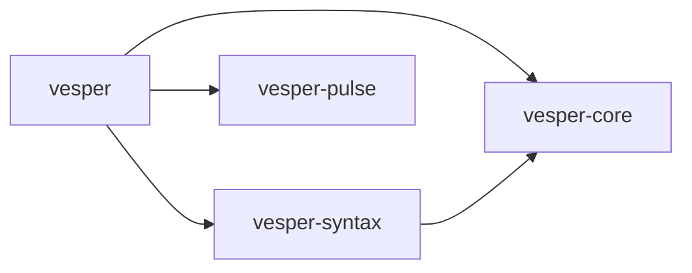

# Workspace boundaries

The first extraction preserves the existing `vesper` API and executable behavior. The root package remains the compiler/evaluator facade, and reexports its original `ast`, `numeric`, `lexer`, `parser`, `frames`, `io_driver`, and `scheduler` module paths.

| Package | Responsibility | Internal dependencies |
| --- | --- | --- |
| `vesper-core` | Source-ranged AST/HIR value types, mode lattice, shared integer semantics | None |
| `vesper-syntax` | Logos lexing, lossless Rowan CST, recovering parser | `vesper-core` |
| `vesper-pulse` | Relative-address frame storage; Linux io_uring driver and completion scheduler | None |
| `vesper` | Checking, Place IR, optimization, native/Lean backends, evaluator, I/O embedding, CLI/LSP | All three leaf crates |



Pulse frame storage builds on every platform. Its io_uring driver and scheduler remain gated to Linux. `io_session` remains in the root package because it depends on both Pulse and the reference evaluator. This extraction does not add native parked execution.

`vesper-core` is an interim shared-types boundary ahead of the larger workspace in design §10. Checking currently invokes Place IR validation, while lowering and IR validation depend on checked `World` metadata and kinding. Those components cannot be extracted into independent `vesper-hir` and `vesper-mir-pcg` crates without first separating shared checked metadata from the checking/lowering orchestration. Native and Lean extraction likewise still depend on that metadata. This change leaves those dependencies intact instead of creating crate cycles or duplicating types.

Working dependency versions are retained. Shared leaf dependencies are declared under `[workspace.dependencies]`; design-document scaffold versions do not override versions already validated by the implementation.

Run the complete workspace checks with:

```sh
cargo fmt --all -- --check
VESPER_LEAN=lean cargo test --workspace --locked
cargo clippy --workspace --locked --all-targets -- -D warnings
```

New parallel-work packages must be registered explicitly in the root workspace members and default-members by the integration owner. Explicit default-members preserve default `cargo test` coverage for the moved Pulse unit tests. The root members list deliberately does not glob unfinished crates.
