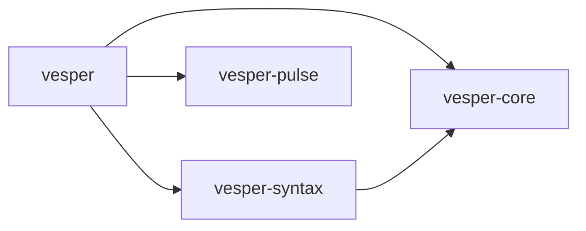

# Workspace boundaries

The first extraction preserves the existing `vesper` API and executable behavior. The root package remains the compiler/evaluator facade, and reexports its original `ast`, `numeric`, `lexer`, `parser`, `frames`, `io_driver`, and `scheduler` module paths.

| Package | Responsibility | Internal dependencies |
| --- | --- | --- |
| `vesper-core` | Source-ranged AST/HIR value types, mode lattice, shared integer semantics | None |
| `vesper-syntax` | Logos lexing, lossless Rowan CST, recovering parser | `vesper-core` |
| `vesper-pulse` | Relative-address frame storage; Linux io_uring driver and completion scheduler | None |
| `vesper` | Checking, Place IR, optimization, native/Lean backends, evaluator, I/O embedding, CLI/LSP | Core, syntax, Pulse |
| `vesper-semver` | Versioned interface DTOs and conservative compatibility checks | None |
| `vesper-ffi` | Validated wire layouts and safe byte views | None |
| `vesper-loom-calculus` | Declarative manifests and proposed-solution validation | None |
| `vesper-loom-solver` | Offline local-catalog version selection | Loom calculus |
| `vesper-alloc` | External Strata host-region core; checked runtime handles | None |
| `vesper-simpulse` | Owned deterministic scheduling, timers, journal/replay | None |
| `vesper-fiber-abi` | Versioned native evidence ABI and pinned-stack park/resume prototype | Pulse |
| `native-pulse-experiment` | Executable hand-written CLIF fiber experiment | Fiber ABI, Pulse |
| `vesper-pact` | Canonical trait goals, tabled solving, coherence and derivation checking | None |
| `vesper-loom-cas` | Immutable BLAKE3 store, derivation records and independent materialization | None |
| `vesper-loom-sandbox` | Wasmtime component build/macro host with deterministic inputs and resource limits | None |
| `vesper-ignis` | GPU-independent render graph, barriers and queue synchronization | None |



Pulse frame storage builds on every platform. Its io_uring driver and scheduler remain gated to Linux. `io_session` remains in the root package because it depends on both Pulse and the reference evaluator. The separate fiber ABI prototype parks hand-written CLIF entries on pinned machine stacks; compiler-generated source programs do not use that path yet.

`vesper-core` is an interim shared-types boundary ahead of the larger workspace in design §10. Checking currently invokes Place IR validation, while lowering and IR validation depend on checked `World` metadata and kinding. Those components cannot be extracted into independent `vesper-hir` and `vesper-mir-pcg` crates without first separating shared checked metadata from the checking/lowering orchestration. Native and Lean extraction likewise still depend on that metadata. This change leaves those dependencies intact instead of creating crate cycles or duplicating types.

Working dependency versions are retained. Shared leaf dependencies are declared under `[workspace.dependencies]`; design-document scaffold versions do not override versions already validated by the implementation.

Run the complete workspace checks with:

```sh
cargo fmt --all -- --check
VESPER_LEAN=lean cargo test --workspace --locked
cargo clippy --workspace --locked --all-targets -- -D warnings
```

New parallel-work packages must be registered explicitly in the root workspace members and default-members by the integration owner. Explicit default-members preserve default `cargo test` coverage for the moved Pulse unit tests. The root members list deliberately does not glob unfinished crates.

The wire-layout and simulator libraries remain standalone tested workspace members. The root now exports experimental source interfaces for SemVer comparison and exposes offline Loom resolution; see [package workflows](../docs/package-workflows.md). Their DTOs and model contracts are intentionally independent of private checker state; see their reports under `docs/parallel-results/` and the [integration contract audit](../docs/rfcs/parallel-contracts.md).

All completed handoff crates and the native experiment are registered in both workspace member lists and share the root lockfile. The sandbox fixture guest remains a separate wasm workspace with its own lockfile. Wasmtime 50 uses Cranelift 0.137 alongside the compiler’s validated Cranelift 0.125; these are intentionally separate dependencies.
